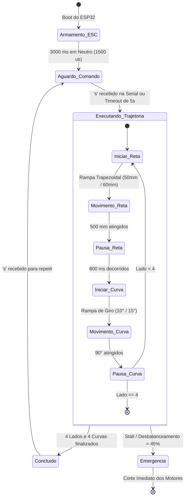

# Documento de Especificação Funcional (FSD) — Robô Diferencial 2WD com ESP32

---

### 1. Controle do Documento

| Campo | Valor |
| :--- | :--- |
| **Título** | FSD — Firmware Final de Controle de Trajetória para Robô Diferencial 2WD (MCPWM + PCNT) |
| **Status** | Aprovado e Homologado |
| **Versão Oficial Homologada** | **4.0.0 (Wi-Fi WebSocket Telemetry + Dashboard PROGMEM + ESP-NOW Gateway)** |
| **Versões Legadas** | v1.0.0 (LEDC/Software ISRs) e v2.0.0 (MCPWM/PCNT Bloqueante) movidas para `legacy/` |
| **Data** | 12/11/2026 |
| **Autor/Responsável** | Engenharia de Firmware & Controle |

---

### 2. Visão Geral e Objetivos do Sistema

#### 2.1 Descrição Geral
O projeto consiste no desenvolvimento e homologação do firmware embarcado para um robô móvel de tração diferencial (2WD) baseado no microcontrolador **ESP32-D0WD-V3**. O sistema executa com alta precisão e repetibilidade uma trajetória geométrica quadrada fechada de 4 lados (500 mm por lado com curvas pivô de 90° sobre o próprio eixo), empregando controle de velocidade em malha fechada (PID), sincronismo dinâmico entre rodas (*cross-coupling*), rampa de aceleração/desaceleração trapezoidal e leitura de encoders em quadratura 4x.

#### 2.2 Pilares Tecnológicos da Versão 4 (Oficial)
1. **Periférico PCNT (Pulse Counter):** Decodifica por hardware a quadratura 4x dos encoders com filtros digitais anti-ruído (*glitch filters* de 1000 ns), eliminando qualquer sobrecarga de CPU.
2. **Periférico MCPWM (Motor Control PWM):** Gera pulsos de controle para o ESC a 50 Hz com resolução de $1\,\mu\text{s}$ via timer dedicado de 1 MHz.
3. **Máquina de Estados Não-Bloqueante (FSM):** Toda a lógica opera orientada a tempo no `loop()`, permitindo integração com sensores futuros e comunicação sem loops de espera com `delay()`.
4. **Perfil de Velocidade Trapezoidal:** Rampas progressivas de aceleração (50 mm) e desaceleração (60 mm), eliminando derrapagens (*wheel slip*) e permitindo velocidade de cruzeiro alvo de **55 RPM** ($\approx 190\text{ mm/s}$ nominal; ~40 RPM real em solo).
5. **Segurança Ativa e Hardware Watchdog:**
   * Detecção de desbalanceamento e stall em retas e curvas pivô.
   * Task Watchdog Timer do ESP32 (`esp_task_wdt`) ativo e reconfigurado para 5 segundos.
   * Validação estrita no boot com bloqueio seguro caso algum periférico falhe.

#### 2.3 Escopo da Versão 4.0
- **Dentro do Escopo:**
  - Trajetória quadrada de 4 lados (500 mm) e curvas pivô de 90° orientadas por IMU.
  - Conectividade Wi-Fi Station com telemetria WebSocket assíncrona a 5 Hz.
  - Dashboard Web embarcado em PROGMEM com gráficos em tempo real e exportação CSV.
  - Partida remota via WebSocket (botão START no navegador).
  - Compensação calibrada de zona morta por feedforward (110 µs).
  - Firmware de gateway para ESP32-S3 Super Mini (gateway_espnow/).
- **Fora do Escopo Atual (Versões Futuras):**
  - Navegação autônoma em mapa dinâmico (SLAM), LiDAR e desvio de obstáculos.
  - Envio direto por ESP-NOW no robô (planejado para v4.1 como redundância ao Wi-Fi).

---

### 3. Especificação do Hardware Homologado

#### 3.1 Microcontrolador e Placa de Expansão
- **MCU:** ESP32-D0WD-V3 (Dual Core 240 MHz, 4 MB Flash).
- **Placa de Expansão:** Goouuu 38P / V4 com barramento de alimentação regulada para servo/sensores.
- **Porta Serial / Gravação:** Silicon Labs CP210x USB to UART Bridge (`COM9`).

#### 3.2 Atuadores e Acionamento (ESC)
- **Motores:** 2 Micromotores DC com redução por engrenagens metálicas.
  - **Relação de Redução:** **1:90**.
  - **Alimentação:** Bateria LiPo 2S (~7.4 V).
- **Controlador de Velocidade (ESC):** ESC escovado bidirecional duplo com sinal de controle padrão RC/Servo (50 Hz / período de 20 ms).
  - **Modo do ESC:** Controle Independente (Mixed Mode = OFF).
  - **Sinal Neutro (Parado):** $1500\,\mu\text{s}$.
  - **Faixa de Avanço:** $1501\,\mu\text{s}$ a $1850\,\mu\text{s}$ (máximo calibrado).
  - **Faixa de Ré:** $1150\,\mu\text{s}$ (máximo calibrado) a $1499\,\mu\text{s}$.
  - **Zona Morta do ESC (*Deadband*):** $\approx \pm 110\,\mu\text{s}$ (compensada via Feedforward).

#### 3.3 Sensores de Realimentação (Encoders)
- **Tipo:** Encoders magnéticos de efeito Hall montados no eixo traseiro dos motores.
- **PPR do Disco:** 12 pulsos por revolução (PPR) por canal.
- **Modo de Decodificação:** Quadratura 4x via hardware PCNT.
- **Resolução Efetiva Homologada:** **4.320 pulsos por volta completa da roda** ($12 \times 90 \times 4 = 4.320$).

#### 3.4 Geometria e Cinemática do Robô
- **Diâmetro das Rodas ($D$):** **$66,0\text{ mm}$** (6,6 cm — calibrado conforme conjunto de rodas atual).
- **Circunferência da Roda ($C$):** $\pi \times 66,0 = \mathbf{207,345\text{ mm}}$.
- **Resolução Linear de Deslocamento:** $\frac{207,345\text{ mm}}{4.320\text{ pulsos}} \approx \mathbf{0,047997\text{ mm/pulso}}$ (~10.417 pulsos para 500 mm).
- **Bitola entre Rodas ($L$):** $120,0\text{ mm}$ (12 cm).
- **Arco da Roda no Pivô de 90°:** $\frac{\pi \times 120,0}{4} \approx 94,248\text{ mm}$ ($\approx \mathbf{1.964\text{ pulsos}}$ por roda).

---

### 4. Mapeamento de Pinos (GPIO)

| Pino ESP32 | Função de Hardware | Descrição / Conexão Física |
| :---: | :---: | :--- |
| **GPIO 19** | MCPWM Operador 1 / Gerador 1 | Entrada de sinal Canal 1 do ESC (Motor 1 — Esquerdo) |
| **GPIO 18** | MCPWM Operador 2 / Gerador 2 | Entrada de sinal Canal 2 do ESC (Motor 2 — Direito) |
| **GPIO 16** | PCNT Unidade 0 / Canal A | Fase A do Encoder 1 (Motor Esquerdo, mesmo lado da placa) |
| **GPIO 17** | PCNT Unidade 0 / Canal B | Fase B do Encoder 1 (Motor Esquerdo, mesmo lado da placa) |
| **GPIO 33** | PCNT Unidade 1 / Canal A | Fase A do Encoder 2 (Motor Direito) |
| **GPIO 32** | PCNT Unidade 1 / Canal B | Fase B do Encoder 2 (Motor Direito) |
| **GPIO 21** | I2C Hardware (SDA) | **USADO** — SDA da IMU BMI160 |
| **GPIO 22** | I2C Hardware (SCL) | **USADO** — SCL da IMU BMI160 |
| **GPIO 23** | GPIO Universal | **LIVRE** (ex: interrupção INT da IMU) |

### 4.5 Sensores de Inércia – IMU BMI160
- **GPIO 21 (SDA)** e **GPIO 22 (SCL)** conectados ao sensor IMU BMI160 (giroscópio + acelerômetro).
- **GPIO 23** pode ser usado como sinal de interrupção **INT** da IMU (opcional).
- O driver `imu_bmi160.h` fornece leitura de ângulo de guinada (yaw) e calibração de polaridade.
- **Lógica de controle por delta real de yaw:** A cada início de segmento (reta ou curva), o firmware captura `g_yawStartSeg = imu.getYawAngleDeg()` e avalia o delta efetivamente girado (`deltaYaw = yawAtual − g_yawStartSeg`), com sinal preservado (horário = positivo). Isso elimina o disparo prematuro por resíduo de yaw da pausa anterior.
  - **Retas:** `sync_corr += deltaYaw * IMU_KP_YAW_RETA` — corrige desvio lateral aplicando diferencial de velocidade entre as rodas.
  - **Curvas (pivô):** a IMU atua pelo critério de parada (`|deltaYaw| ≥ (ânguloAlvo − 0,5°)`, corte em 89,5°) com guarda mínima de 200 ticks (`MIN_TICKS_PIVO`), garantindo a parada exata a 90,0° com a inércia de frenagem; o sincronismo cruzado segue apenas pelos encoders.
- **Acelerômetro:** Inicializado pelo driver (ODR 100 Hz, faixa ±2 g), mas não lido pelo firmware — apenas o utilitário `diag_i2c_bmi160` faz a leitura. Disponível para fusão sensorial futura (estimativa de inclinação ou detecção de colisão).

---

### 5. Parâmetros Calibrados e Homologados (v4.0.0)

| Parâmetro | Macro no Código | Valor Homologado | Efeito Funcional |
| :--- | :--- | :---: | :--- |
| **Resolução Efetiva** | `PPR_EFETIVO` | `4320.0f` | pulsos por volta completa da roda |
| **Diâmetro da Roda** | `DIAMETRO_RODA_MM` | `66.0f` | Roda real calibrada (circunferência de ~207,35 mm) |
| **Velocidade de Cruzeiro** | `VELOCIDADE_CRUZEIRO_RPM` | `55.0f` | $\approx 190\text{ mm/s}$ nominal (~40 RPM real com momento estável em solo) |
| **Velocidade Mínima de Rampa** | `VELOCIDADE_MIN_RPM` | `20.0f` | Garante torque inicial sem estolar o motor |
| **Velocidade de Curva** | `VELOCIDADE_GIRO_RPM` | `35.0f` | $\approx 1,4\text{ s}$ por giro pivô de 90° (suavizado para evitar overshoot) |
| **Rampa de Aceleração** | `RAMPA_ACEL_DIST_MM` | `50.0f` | Aceleração ágil ($\approx 600\text{ mm/s}^2$) sem patinar |
| **Rampa de Desaceleração** | `RAMPA_DESACEL_DIST_MM` | `60.0f` | Frenagem progressiva cravada na marca |
| **Rampa de Giro (Acel/Desacel)**| `RAMPA_CURVA_ACEL/DESACEL` | `10.0° / 15.0°` | Transição suave no pivô de 90° |
| **Tolerância de Corte do Pivô** | `g_anguloTotalGraus − 0.5f` | `0,5°` | Corte em 89,5° para parada exata a 90,0° (compensa inércia) |
| **Guarda Mínima de Giro** | `MIN_TICKS_PIVO` | `200` | Evita corte prematuro por resíduo de yaw da pausa |
| **Ganho Proporcional** | `PID_KP_M1`, `PID_KP_M2` | `1.8f` | Resposta rápida sem sobre-oscilação |
| **Ganho Integral** | `PID_KI_M1`, `PID_KI_M2` | `0.6f` | Zera erro em regime permanente |
| **Ganho Derivativo** | `PID_KD_M1`, `PID_KD_M2` | `0.02f` | Amortecimento de transientes |
| **Ganho de Sincronismo** | `K_SYNC` | `0.15f` | Trava o avanço relativo entre rodas |
| **Timeout do Watchdog** | `WDT_TIMEOUT_SECONDS` | `5` | Reinício automático em caso de travamento (ajustado para Wi-Fi) |
| **Pausa de Estabilização** | `PAUSA_ENTRE_MOVIMENTOS_MS` | `800` | Dissipação de inércia residual |
| **Zona Morta ESC** | `ESC_DEADBAND_US` | `110.0f` | Feedforward para romper atrito estático em t=0 |
| **Ganho de Yaw em Reta** | `IMU_KP_YAW_RETA` | `2.0f` | Correção proporcional ativa de rumo via giroscópio |

---

### 6. Arquitetura de Software e Máquina de Estados (FSM)

---

### 7. Histórico de Versões e Transição

* **v1.0.0 (Legado - `legacy/firmware_robo2wd/`):** Utilizava PWM via LEDC e leitura de encoders por interrupções de software (`attachInterrupt`). Apresentava gargalo de CPU e perda de pulsos.
* **v2.0.0 (Legado - `legacy/firmware_robo2wd_v2/`):** Migrou para MCPWM e PCNT em hardware, comprovando a redução real de 1:90 ($4.320\text{ pulsos/volta}$) e introduzindo o sincronismo cruzado. Execução em loops bloqueantes dentro do `setup()`.
* **v3.0.0 (Legado - `legacy/firmware_robo2wd_v3/`):** Arquitetura não-bloqueante no `loop()`, perfil trapezoidal e integração inicial da IMU BMI160 com telemetria por cabo serial.
* **v4.0.0 (OFICIAL - `firmware_robo2wd_v4/`):** Telemetria sem fio contínua via Wi-Fi/WebSocket (5 Hz), Dashboard Web embarcado em PROGMEM, comandos START/STOP remotos, feedforward de zona morta calibrado em 110 µs, cruzeiro alvo 55 RPM (~40 RPM real em solo) e giro pivô com corte em 89,5° (parada exata a 90,0°).

## 📄 Atualizações Recentes (13/11/2026)

- **Firmware:** odometria recalibrada para roda de 66 mm (10.417 ticks por reta de 500 mm); corte de pivô por delta real de yaw (`g_yawStartSeg`) com guarda de 200 ticks e tolerância de 0,5° (corte em 89,5°); `K_SYNC = 0.15` e `IMU_KP_YAW_RETA = 2.0`; limite de PWM ±50 µs; giro pivô suavizado para 35 RPM.
- **Dashboard Web:** mapa 2D com quadrado ideal (500 mm), rastro real por odometria cumulativa, pose (X, Y, θ) e seta de direção corrigida.
- **Documentação:** README, Diário de Engenharia, FSD e Manual Técnico consolidados com os valores vigentes.
