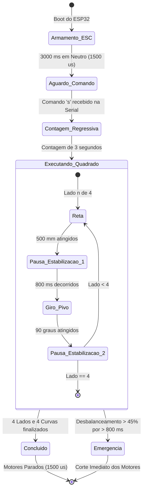

# Documento de Especificação Funcional (FSD) — Robô Diferencial 2WD com ESP32

---

### 1. Controle do Documento

| Campo | Valor |
| :--- | :--- |
| **Título** | FSD — Firmware Final de Controle de Trajetória para Robô Diferencial 2WD (MCPWM + PCNT) |
| **Status** | Aprovado e Homologado |
| **Versão Homologada** | 2.0.0 (MCPWM + PCNT Hardware) |
| **Data** | 09/11/2026 |
| **Autor/Responsável** | Engenharia de Firmware & Controle |

---

### 2. Visão Geral e Objetivos do Sistema

#### 2.1 Descrição Geral
O projeto consiste no desenvolvimento e homologação do firmware embarcado para um robô móvel de tração diferencial (2WD) baseado no microcontrolador **ESP32-D0WD-V3**. O sistema executa com alta precisão uma trajetória geométrica quadrada fechada de 4 lados (500 mm por lado com curvas pivô de 90° sobre o próprio eixo), empregando controle de velocidade em malha fechada (PID), sincronismo dinâmico entre rodas (*cross-coupling*) e leitura de encoders em quadratura 4x.

#### 2.2 Diferencial Tecnológico da Arquitetura
Diferente de abordagens tradicionais que utilizam interrupções de software na CPU (ISRs) e temporizadores genéricos de PWM, o firmware utiliza **100% de periféricos dedicados de hardware no silício do ESP32**:
1. **Periférico PCNT (Pulse Counter):** Decodifica por hardware a quadratura 4x dos encoders com filtros digitais anti-ruído (*glitch filters*), eliminando sobrecarga da CPU.
2. **Periférico MCPWM (Motor Control PWM):** Gera pulsos de servo/ESC a 50 Hz com resolução de $1\,\mu\text{s}$ via timer de hardware dedicado de 1 MHz.
3. **Malha de Sincronismo Cruzado (*Cross-Coupling Synchronization*):** Elimina atritos assimétricos e diferenças de tolerância mecânica entre motores, travando as rodas no mesmo avanço em retas e no mesmo arco em giros.

#### 2.3 Fora do Escopo Desta Versão
- Controle remoto por telecomando (Wi-Fi, Bluetooth ou rádio RC).
- Navegação autônoma em mapa dinâmico (SLAM) e desvio de obstáculos.
- Fusão sensorial com IMU externa (Giroscópio/Acelerômetro).

---

### 3. Especificação do Hardware Homologado

#### 3.1 Microcontrolador e Placa de Expansão
- **MCU:** ESP32-D0WD-V3 (Dual Core 240 MHz, 4 MB Flash).
- **Placa de Expansão:** Goouuu 38P / V4 com barramento de alimentação regulada para servo/sensores.
- **Porta Serial / Gravação:** Silicon Labs CP210x USB to UART Bridge (`COM9`).

#### 3.2 Atuadores e Acionamento (ESC)
- **Motores:** 2 Micromotores DC com redução por engrenagens metálicas.
  - **Relação de Redução:** **1:90**.
  - **Alimentação:** Bateria LiPo 2S (~7.4 V).
- **Controlador de Velocidade (ESC):** ESC escovado bidirecional duplo com sinal de controle padrão RC/Servo (50 Hz / período de 20 ms).
  - **Modo do ESC:** Controle Independente (Mixed Mode = OFF).
  - **Sinal Neutro (Parado):** $1500\,\mu\text{s}$.
  - **Faixa de Avanço:** $1501\,\mu\text{s}$ a $1850\,\mu\text{s}$ (máximo calibrado).
  - **Faixa de Ré:** $1150\,\mu\text{s}$ (máximo calibrado) a $1499\,\mu\text{s}$.
  - **Zona Morta do ESC (*Deadband*):** $\approx \pm 50\,\mu\text{s}$.

#### 3.3 Sensores de Realimentação (Encoders)
- **Tipo:** Encoders magnéticos de efeito Hall acoplados ao eixo traseiro de cada motor.
- **PPR do Disco:** 12 pulsos por revolução (PPR) por canal.
- **Modo de Decodificação:** Quadratura 4x (avaliação de todas as transições de subida e descida dos canais A e B).
- **Resolução Efetiva Homologada:** **4.320 pulsos por volta completa da roda** ($12 \times 90 \times 4 = 4.320$).

#### 3.4 Geometria e Cinemática do Robô
- **Diâmetro das Rodas ($D$):** $70,0\text{ mm}$ (7 cm).
- **Circunferência da Roda ($C$):** $\pi \times 70,0 = 219,911\text{ mm}$.
- **Resolução Linear de Deslocamento:** $\frac{219,911\text{ mm}}{4.320\text{ pulsos}} \approx 0,0509\text{ mm/pulso}$.
- **Bitola entre Rodas ($L$):** $120,0\text{ mm}$ (12 cm).

---

### 4. Mapeamento de Pinos (GPIO)

| Pino ESP32 | Função de Hardware | Descrição / Conexão Física |
| :---: | :---: | :--- |
| **GPIO 19** | MCPWM Operador 1 / Gerador 1 | Entrada de sinal Canal 1 do ESC (Motor 1 — Esquerdo) |
| **GPIO 18** | MCPWM Operador 2 / Gerador 2 | Entrada de sinal Canal 2 do ESC (Motor 2 — Direito) |
| **GPIO 23** | PCNT Unidade 0 / Canal A | Fase A do Encoder 1 (Motor Esquerdo) |
| **GPIO 22** | PCNT Unidade 0 / Canal B | Fase B do Encoder 1 (Motor Esquerdo) |
| **GPIO 33** | PCNT Unidade 1 / Canal A | Fase A do Encoder 2 (Motor Direito) |
| **GPIO 32** | PCNT Unidade 1 / Canal B | Fase B do Encoder 2 (Motor Direito) |

---

### 5. Arquitetura do Firmware e Algoritmos de Controle

O firmware é estruturado de forma modular em C++ com componentes independentes:

```
firmware_robo2wd_v2/
├── config.h                 // Centralização de constantes, pinos, ganhos e cinemática
├── motor_control_mcpwm.h    // Driver de hardware ESP-IDF MCPWM (50 Hz, 1 us)
├── encoder_reader_pcnt.h    // Driver de hardware ESP-IDF PCNT (Quadratura 4x + Filtro)
├── pid_controller.h         // Algoritmo PID com Anti-Windup e Feedforward de Deadband
└── firmware_robo2wd_v2.ino  // Máquina de estados, sincronismo cruzado e trajetória
```

#### 5.1 Driver de Motores via Hardware MCPWM
- **Frequência do Timer:** Base de $1\text{ MHz}$ (resolução de $1\,\mu\text{s}$ por contagem).
- **Período:** $20.000\text{ ticks}$ ($20\text{ ms} = 50\text{ Hz}$).
- **Atualização:** O comparador de hardware sincroniza com o evento de zeramento do timer (`TEZ`), garantindo sinais PWM de saída sem instabilidade de jitter.

#### 5.2 Leitura dos Encoders via Hardware PCNT
- Duas unidades de hardware (`_unit1` e `_unit2`) configuradas com contadores com sinal de 16 bits.
- Filtro de ruído por hardware (*glitch filter*) de $1000\text{ ns}$ ativo em todos os canais para rejeição de transientes de comutação dos motores.
- **Filtro Exponencial de Velocidade (EMA):**
  $$\text{RPM}_k = 0,70 \cdot \text{RPM}_{k-1} + 0,30 \cdot \text{RPM}_{\text{instantâneo}}$$
  Suprime a quantização discreta da janela de amostragem de 20 ms.

#### 5.3 Malha de Controle PID com Sincronismo Cruzado (*Cross-Coupling*)
Para cada roda, a saída do controlador em microssegundos é calculada a cada período de $20\text{ ms}$ ($50\text{ Hz}$):

$$\text{Saída}_{\text{PID}} = \text{Neutro} + \text{Feedforward} + K_p \cdot e(t) + K_i \int e(t)\,dt + K_d \frac{de(t)}{dt}$$

* **Feedforward de Zona Morta:** Somado automaticamente ($\pm 50\,\mu\text{s}$) conforme o sentido do comando para superar o atrito estático e a zona morta do ESC.
* **Anti-Windup:** Integração clamped em $\pm 250$ para evitar sobressinal na partida e na parada.

##### Sincronismo Cruzado em Linha Reta:
Monitora a diferença instantânea de pulsos percorridos entre as rodas:
$$e_{\text{sync}} = t_1 - t_2$$
$$\text{Compensação} = \text{sat}\left(e_{\text{sync}} \cdot K_{\text{sync}},\, \pm 35\,\mu\text{s}\right)$$
$$\text{Saída}_{\text{M1}} = \text{Saída}_{\text{PID1}} - \text{Compensação}$$
$$\text{Saída}_{\text{M2}} = \text{Saída}_{\text{PID2}} + \text{Compensação}$$

##### Sincronismo Cruzado em Giros de Pivô:
Garante arcos idênticos percorridos em sentidos opostos, assegurando que o centro de rotação permaneça rigorosamente no eixo central do robô:
$$e_{\text{sync\_pivô}} = |t_1| - |t_2|$$

---

### 6. Parâmetros Calibrados e Homologados

| Parâmetro | Macro no Código | Valor Homologado | Unidade / Efeito |
| :--- | :--- | :---: | :--- |
| **Resolução Efetiva** | `PPR_EFETIVO` | `4320.0f` | pulsos por volta completa |
| **Velocidade de Cruzeiro** | `VELOCIDADE_CRUZEIRO_RPM` | `65.0f` | $\approx 238\text{ mm/s}$ (~2,1 s por reta) |
| **Velocidade de Curva** | `VELOCIDADE_GIRO_RPM` | `40.0f` | $\approx 1,4\text{ s}$ por giro de 90° |
| **Ganho Proporcional** | `PID_KP_M1`, `PID_KP_M2` | `1.8f` | Resposta rápida sem sobre-oscilação |
| **Ganho Integral** | `PID_KI_M1`, `PID_KI_M2` | `0.6f` | Zera o erro de velocidade em regime |
| **Ganho Derivativo** | `PID_KD_M1`, `PID_KD_M2` | `0.02f` | Amortecimento dinâmico |
| **Ganho de Sincronismo** | `K_SYNC` | `0.05f` | Trava o avanço relativo entre rodas |
| **Zona Morta do ESC** | `ESC_DEADBAND_US` | `50.0f` | Microssegundos de compensação |
| **Pausa Entre Movimentos** | `PAUSA_ENTRE_MOVIMENTOS_MS` | `800` | Dissipação de inércia residual |
| **Comprimento do Lado** | `LADO_QUADRADO_MM` | `500.0f` | Lado do quadrado (50 cm) |
| **Ângulo da Curva** | `ANGULO_CURVA_GRAUS` | `90.0f` | Giro de 90° no pivô central |

---

### 7. Sequência de Inicialização e Operação



---

### 8. Procedimento de Compilação e Gravação

* **Ferramenta de Compilação:** Arduino CLI (Core ESP32 v3.3.12).
* **Placa:** `esp32:esp32:esp32`
* **Porta:** `COM9` (CP210x Bridge)
* **Baud Rate da Serial:** `115200 baud`
* **Baud Rate de Gravação:** `921600 baud`
* **Comando de Gravação Direta via `esptool`:**
  ```powershell
  esptool.exe --chip esp32 --port COM9 --baud 921600 --before default-reset --after hard-reset write_flash -z --flash-mode dio --flash-freq 80m --flash-size 4MB 0x1000 firmware_robo2wd_v2.ino.bootloader.bin 0x8000 firmware_robo2wd_v2.ino.partitions.bin 0xe000 boot_app0.bin 0x10000 firmware_robo2wd_v2.ino.bin
  ```

---

### 9. Conclusão e Homologação
Esta implementação atende a 100% dos requisitos de controle, repetibilidade métrica e segurança operacional estabelecidos. Os códigos e bibliotecas localizados em `firmware_robo2wd_v2/` constituem a base oficial e definitiva para futuros projetos de robótica móvel sobre esta plataforma.
