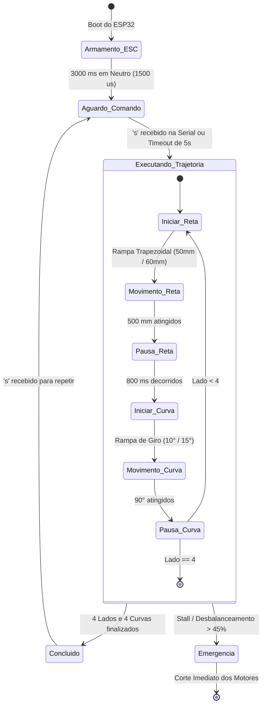

# Documento de Especificação Funcional (FSD) — Robô Diferencial 2WD com ESP32

---

### 1. Controle do Documento

| Campo | Valor |
| :--- | :--- |
| **Título** | FSD — Firmware Final de Controle de Trajetória para Robô Diferencial 2WD (MCPWM + PCNT) |
| **Status** | Aprovado e Homologado |
| **Versão Oficial Homologada** | **3.0.0 (MCPWM + PCNT Hardware + FSM Não-Bloqueante + Perfil Trapezoidal)** |
| **Versões Legadas** | v1.0.0 (LEDC/Software ISRs) e v2.0.0 (MCPWM/PCNT Bloqueante) movidas para `legacy/` |
| **Data** | 10/11/2026 |
| **Autor/Responsável** | Engenharia de Firmware & Controle |

---

### 2. Visão Geral e Objetivos do Sistema

#### 2.1 Descrição Geral
O projeto consiste no desenvolvimento e homologação do firmware embarcado para um robô móvel de tração diferencial (2WD) baseado no microcontrolador **ESP32-D0WD-V3**. O sistema executa com alta precisão e repetibilidade uma trajetória geométrica quadrada fechada de 4 lados (500 mm por lado com curvas pivô de 90° sobre o próprio eixo), empregando controle de velocidade em malha fechada (PID), sincronismo dinâmico entre rodas (*cross-coupling*), rampa de aceleração/desaceleração trapezoidal e leitura de encoders em quadratura 4x.

#### 2.2 Pilares Tecnológicos da Versão 3 (Oficial)
1. **Periférico PCNT (Pulse Counter):** Decodifica por hardware a quadratura 4x dos encoders com filtros digitais anti-ruído (*glitch filters* de 1000 ns), eliminando qualquer sobrecarga de CPU.
2. **Periférico MCPWM (Motor Control PWM):** Gera pulsos de controle para o ESC a 50 Hz com resolução de $1\,\mu\text{s}$ via timer dedicado de 1 MHz.
3. **Máquina de Estados Não-Bloqueante (FSM):** Toda a lógica opera orientada a tempo no `loop()`, permitindo integração com sensores futuros e comunicação sem loops de espera com `delay()`.
4. **Perfil de Velocidade Trapezoidal:** Rampas progressivas de aceleração (50 mm) e desaceleração (60 mm), eliminando derrapagens (*wheel slip*) e permitindo velocidade de cruzeiro de **80 RPM** ($\approx 293\text{ mm/s}$).
5. **Segurança Ativa e Hardware Watchdog:**
   * Detecção de desbalanceamento e stall em retas e curvas pivô.
   * Task Watchdog Timer do ESP32 (`esp_task_wdt`) ativo e reconfigurado para 3 segundos.
   * Validação estrita no boot com bloqueio seguro caso algum periférico falhe.

#### 2.3 Fora do Escopo Desta Versão
- Controle remoto por telecomando (Wi-Fi, Bluetooth ou rádio RC).
- Navegação autônoma em mapa dinâmico (SLAM) e desvio de obstáculos.
- Fusão sensorial com IMU externa (Giroscópio/Acelerômetro).

---

### 3. Especificação do Hardware Homologado

#### 3.1 Microcontrolador e Placa de Expansão
- **MCU:** ESP32-D0WD-V3 (Dual Core 240 MHz, 4 MB Flash).
- **Placa de Expansão:** Goouuu 38P / V4 com barramento de alimentação regulada para servo/sensores.
- **Porta Serial / Gravação:** Silicon Labs CP210x USB to UART Bridge (`COM9`).

#### 3.2 Atuadores e Acionamento (ESC)
- **Motores:** 2 Micromotores DC com redução por engrenagens metálicas.
  - **Relação de Redução:** **1:90**.
  - **Alimentação:** Bateria LiPo 2S (~7.4 V).
- **Controlador de Velocidade (ESC):** ESC escovado bidirecional duplo com sinal de controle padrão RC/Servo (50 Hz / período de 20 ms).
  - **Modo do ESC:** Controle Independente (Mixed Mode = OFF).
  - **Sinal Neutro (Parado):** $1500\,\mu\text{s}$.
  - **Faixa de Avanço:** $1501\,\mu\text{s}$ a $1850\,\mu\text{s}$ (máximo calibrado).
  - **Faixa de Ré:** $1150\,\mu\text{s}$ (máximo calibrado) a $1499\,\mu\text{s}$.
  - **Zona Morta do ESC (*Deadband*):** $\approx \pm 50\,\mu\text{s}$ (compensada via Feedforward).

#### 3.3 Sensores de Realimentação (Encoders)
- **Tipo:** Encoders magnéticos de efeito Hall montados no eixo traseiro dos motores.
- **PPR do Disco:** 12 pulsos por revolução (PPR) por canal.
- **Modo de Decodificação:** Quadratura 4x via hardware PCNT.
- **Resolução Efetiva Homologada:** **4.320 pulsos por volta completa da roda** ($12 \times 90 \times 4 = 4.320$).

#### 3.4 Geometria e Cinemática do Robô
- **Diâmetro das Rodas ($D$):** $70,0\text{ mm}$ (7 cm).
- **Circunferência da Roda ($C$):** $\pi \times 70,0 = 219,911\text{ mm}$.
- **Resolução Linear de Deslocamento:** $\frac{219,911\text{ mm}}{4.320\text{ pulsos}} \approx 0,0509\text{ mm/pulso}$.
- **Bitola entre Rodas ($L$):** $120,0\text{ mm}$ (12 cm).

---

### 4. Mapeamento de Pinos (GPIO)

| Pino ESP32 | Função de Hardware | Descrição / Conexão Física |
| :---: | :---: | :--- |
| **GPIO 19** | MCPWM Operador 1 / Gerador 1 | Entrada de sinal Canal 1 do ESC (Motor 1 — Esquerdo) |
| **GPIO 18** | MCPWM Operador 2 / Gerador 2 | Entrada de sinal Canal 2 do ESC (Motor 2 — Direito) |
| **GPIO 16** | PCNT Unidade 0 / Canal A | Fase A do Encoder 1 (Motor Esquerdo, mesmo lado da placa) |
| **GPIO 17** | PCNT Unidade 0 / Canal B | Fase B do Encoder 1 (Motor Esquerdo, mesmo lado da placa) |
| **GPIO 33** | PCNT Unidade 1 / Canal A | Fase A do Encoder 2 (Motor Direito) |
| **GPIO 32** | PCNT Unidade 1 / Canal B | Fase B do Encoder 2 (Motor Direito) |
| **GPIO 21** | I2C Hardware (SDA) | **LIVRE** para barramento I2C (Dispositivos / Sensores) |
| **GPIO 22** | I2C Hardware (SCL) | **LIVRE** para barramento I2C (Dispositivos / Sensores) |
| **GPIO 23** | GPIO Universal | **LIVRE** (ex: interrupção INT da IMU) |

---

### 5. Parâmetros Calibrados e Homologados (v3.0.0)

| Parâmetro | Macro no Código | Valor Homologado | Efeito Funcional |
| :--- | :--- | :---: | :--- |
| **Resolução Efetiva** | `PPR_EFETIVO` | `4320.0f` | pulsos por volta completa da roda |
| **Velocidade de Cruzeiro** | `VELOCIDADE_CRUZEIRO_RPM` | `80.0f` | $\approx 293\text{ mm/s}$ (~1,88 s por lado de 500 mm) |
| **Velocidade Mínima de Rampa** | `VELOCIDADE_MIN_RPM` | `20.0f` | Garante torque inicial sem estolar o motor |
| **Velocidade de Curva** | `VELOCIDADE_GIRO_RPM` | `50.0f` | $\approx 0,52\text{ s}$ por giro de 90° |
| **Rampa de Aceleração** | `RAMPA_ACEL_DIST_MM` | `50.0f` | Aceleração ágil ($\approx 600\text{ mm/s}^2$) sem patinar |
| **Rampa de Desaceleração** | `RAMPA_DESACEL_DIST_MM` | `60.0f` | Frenagem progressiva cravada na marca |
| **Rampa de Giro (Acel/Desacel)**| `RAMPA_CURVA_ACEL/DESACEL` | `10.0° / 15.0°` | Transição suave no pivô de 90° |
| **Ganho Proporcional** | `PID_KP_M1`, `PID_KP_M2` | `1.8f` | Resposta rápida sem sobre-oscilação |
| **Ganho Integral** | `PID_KI_M1`, `PID_KI_M2` | `0.6f` | Zera erro em regime permanente |
| **Ganho Derivativo** | `PID_KD_M1`, `PID_KD_M2` | `0.02f` | Amortecimento de transientes |
| **Ganho de Sincronismo** | `K_SYNC` | `0.05f` | Trava o avanço relativo entre rodas |
| **Timeout do Watchdog** | `WDT_TIMEOUT_SECONDS` | `3` | Reinício automático em caso de travamento |
| **Pausa de Estabilização** | `PAUSA_ENTRE_MOVIMENTOS_MS` | `800` | Dissipação de inércia residual |

---

### 6. Arquitetura de Software e Máquina de Estados (FSM)

---

### 7. Histórico de Versões e Transição

* **v1.0.0 (Legado - `legacy/firmware_robo2wd/`):** Utilizava PWM via LEDC e leitura de encoders por interrupções de software (`attachInterrupt`). Apresentava gargalo de CPU e perda de pulsos.
* **v2.0.0 (Legado - `legacy/firmware_robo2wd_v2/`):** Migrou para MCPWM e PCNT em hardware, comprovando a redução real de 1:90 ($4.320\text{ pulsos/volta}$) e introduzindo o sincronismo cruzado. Execução em loops bloqueantes dentro do `setup()`.
* **v3.0.0 (OFICIAL - `firmware_robo2wd_v3/`):** Arquitetura definitiva não-bloqueante no `loop()`, perfil trapezoidal de velocidade otimizado para 80 RPM, Task Watchdog Timer reconfigurado e checagem de stall em retas e curvas.
